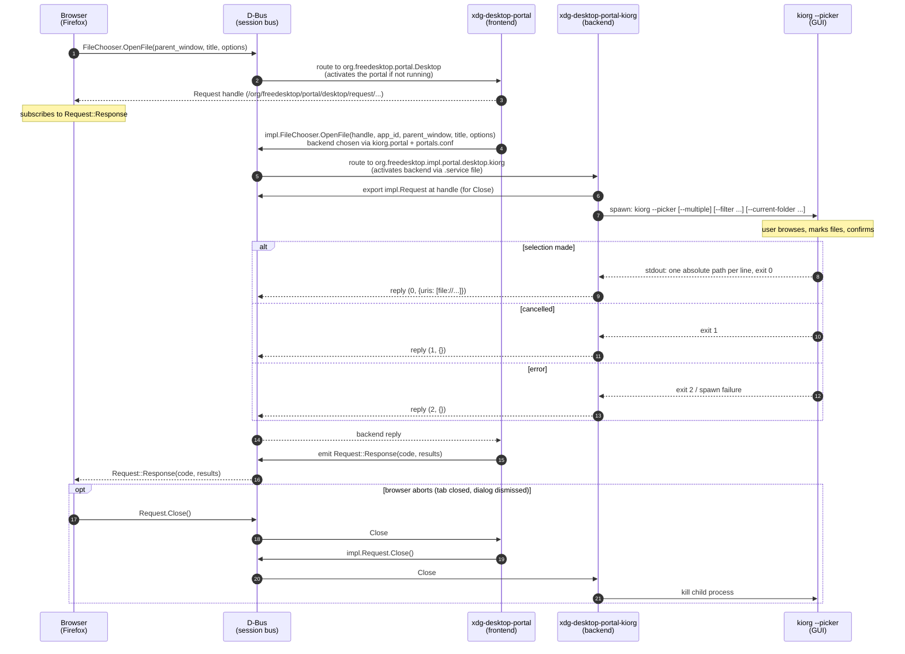

# xdg-desktop-portal-kiorg

Portal backend for `org.freedesktop.impl.portal.FileChooser` that launches `kiorg --picker`.

## Build & install (user-local example)

```sh
cargo build --release
sudo install -Dm755 target/release/xdg-desktop-portal-kiorg /usr/libexec/xdg-desktop-portal-kiorg
sudo install -Dm644 data/kiorg.portal /usr/share/xdg-desktop-portal/portals/kiorg.portal
sudo install -Dm644 data/org.freedesktop.impl.portal.desktop.kiorg.service /usr/share/dbus-1/services/
sudo install -Dm644 data/xdg-desktop-portal-kiorg.service /usr/lib/systemd/user/
mkdir -p ~/.config/xdg-desktop-portal && cp data/portals.conf.example ~/.config/xdg-desktop-portal/portals.conf
systemctl --user restart xdg-desktop-portal
```

Firefox: `about:config` -> `widget.use-xdg-desktop-portal.file-picker = 1`.

```
## Kiorg picker contract
```

kiorg --picker [--directory | --save] [--multiple] [--title T] [--accept-label L]
      [--current-folder DIR] [--current-name NAME]
stdout: one absolute path per line; exit 0 = selection (empty = cancel), exit 1 = cancel

```
Override binary with `KIORG_PICKER_BIN`. Debug logs: `RUST_LOG=debug`.


# Communication


